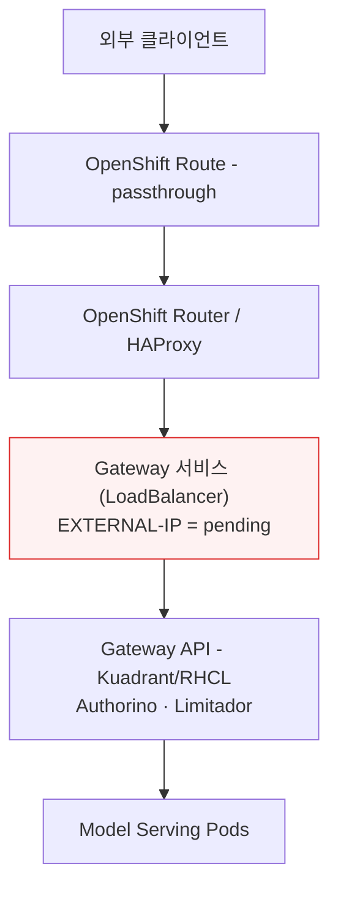
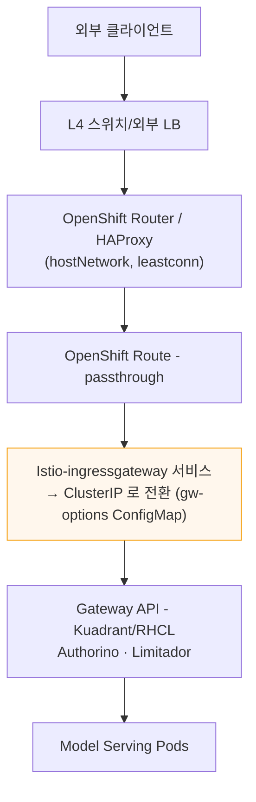

# MaaS Gateway 외부 노출 — LoadBalancer 미사용 환경 정리

> **대상**: Red Hat OpenShift AI (RHOAI) Self-Managed **3.5** / OpenShift **4.22**
> **주제**: MaaS(Models-as-a-Service) Gateway를 **MetalLB(LoadBalancer) 없이** 외부로 노출하는 방법과 그 한계
> **최종 업데이트**: 2026-10-16

---

## 1. 배경

- MaaS는 **Gateway API(Kuadrant / Red Hat Connectivity Link)** 위에서 동작한다.
- MaaS를 배포하면 Gateway용 서비스가 자동 생성되며, **기본 타입은 `LoadBalancer`** 이다.
- 온프렘(베어메탈)에서 `LoadBalancer` 서비스가 외부 IP를 받으려면 **LB provider(MetalLB 등)** 가 필요하다.

### 고객 상황 (우리은행 사례)
1. 초기에 **MetalLB(BGP)** 를 검토했으나, **SLB를 Gateway로 쓰는 IP 대역에 이미 VM들이 배치**되어 있어 BGP 구성이 어려웠다.
2. 내부 사정으로 MetalLB 방안을 **드롭**하고 다른 방안을 찾게 되었다.

---

## 2. 공식 문서가 말하는 것

RHOAI 3.5 MaaS 공식 문서(`deploy-and-manage-models-as-a-service`)에는 다음과 같이 적혀 있다.

> **OpenShift Route**
> If your cluster does not support LoadBalancer services, such as bare metal or
> restricted environments, you might need to create an OpenShift Route for external
> access **if the Gateway controller does not auto-provision one.** Check for an
> auto-provisioned Route before creating one manually.

- 즉 **"LB 없는 환경 → OpenShift Route로 외부 노출"** 이라는 **방향만** 제시한다.
- **문서에 없는 것**: "LB 서비스가 `pending`으로 남는다", "그 상태를 둬도 되는지", "정상 동작 보장" 등 **구체적 설명은 없음**.

---

## 3. 핵심 메커니즘 — 왜 `pending`이 생기나

```
1. MaaS Gateway 생성
      → Gateway용 서비스 자동 생성 (기본 타입 = LoadBalancer)

2. LB provider(MetalLB 등) 없음
      → LoadBalancer 서비스에 외부 IP를 줄 주체가 없음
      → EXTERNAL-IP = <pending>   (쿠버네티스 기본 동작, 회피 불가)

3. 문서 지시대로 "OpenShift Route" 생성
      → Route는 별도 객체 → 서비스 타입을 바꾸지 않음
      → LoadBalancer 서비스는 여전히 <pending> 으로 남음 (공존)
```

**중요**: Route를 만드는 것은 `pending`을 **없애는 것이 아니라**, `pending` LB **옆에 우회 입구를 하나 더** 세우는 것이다.

### 트래픽은 왜 되나

- `LoadBalancer` 서비스도 내부적으로는 **ClusterIP를 항상 갖는다.**
- Route는 서비스를 **이름으로** 연결 → 그 **ClusterIP 엔드포인트**로 트래픽을 보낸다.
- `pending`인 것은 서비스의 **`EXTERNAL-IP` 필드 하나**뿐이고, 이 구성에서는 아무도 그 필드를 쓰지 않는다.

```
외부 호출 ──▶ OpenShift Route ──▶ Router(HAProxy) ──▶ 서비스 ClusterIP 엔드포인트 ──▶ Gateway(Envoy) ──▶ Model Pod
                                                        ▲
                       pending 인 EXTERNAL-IP 는 이 경로에 쓰이지 않음 → 무시됨
```

---

## 4. 두 가지 구성 비교

### (A) 공식 문서 구성 — LB `pending` 유지 + Route



### (B) 방안1 (우리은행 현행) — ClusterIP 전환 + Route



### 요약 표

| 항목 | (A) 공식 문서 구성 | (B) 방안1 (우리은행) |
|---|---|---|
| Gateway 서비스 타입 | `LoadBalancer` (그대로) | **`ClusterIP` 로 전환** |
| `pending` 현상 | **발생 (무시하고 사용)** | 발생 안 함 |
| 전환 수단 | 없음 | `gw-options` ConfigMap (`spec.infrastructure.parametersRef`) |
| 외부 노출 | OpenShift Route | OpenShift Route (+ 앞단 L4/Router) |
| 공식 지원 | **Route 노출은 문서에 명시** | **ClusterIP 전환은 공식 문서에 없음 (커뮤니티/RFE 영역)** |
| 필요 조치 | Support 확인 권고 | **Support Exception 권고** |

> **핵심 차이**: 두 구성 모두 "결국 Route로 노출"한다는 뼈대는 같다.
> 차이는 뒤에 매달린 Gateway 서비스를 **ClusterIP로 전환하느냐(B·미지원)** / **LB `pending` 그대로 두느냐(A·문서)** 뿐이다.

---

## 5. 주의 / 확인 필요 지점

| 관점 | `pending` 무시 가능? | 비고 |
|---|---|---|
| **트래픽 호출** (데이터플레인) | ✅ 가능 | Route로 우회 |
| **Gateway 상태 / 설치 로직** | ⚠️ 경우에 따라 불가 | 아래 참조 |

- Gateway API 리소스는 주소를 받아야 `PROGRAMMED=True`가 되는데, LB가 `pending`이면 이 상태가 안 올라올 수 있다.
- MaaS 배포/헬스체크가 "Gateway 준비됨"을 **LB 주소로 판단**하면 **설치가 멈출(stall)** 수 있다 (커뮤니티 이슈 #331).
  - 이때는 Route를 **수동 생성**하거나 상태를 보정해야 한다.

**→ "`pending`을 둔 채 Route 노출이 정식 지원·정상 동작인가"** 가 Support에 확인할 핵심 포인트.

---

## 6. RFE — 근본 개선

- **RFE: OCPSTRAT-3781** (= RFE-9734 / RFE-9090)
- 요지: **Gateway 서비스 타입으로 `ClusterIP`를 정식 지원**
  - 결과적으로 **LB 서비스 자체가 생성되지 않음 → `pending`이 원천적으로 발생하지 않음**
  - 동시에 해당 구성이 **"지원(supported)"** 상태가 됨
- GA 목표: **~OpenShift 5.1** (계획 기준, 시점 변동 가능)

> 즉 RFE는 단순히 "`pending` 제거"가 아니라, **ClusterIP 구성을 커뮤니티 핵이 아닌 제품 기본 기능으로 정식 지원**하는 것이 본질이며, `pending` 미발생은 그 결과다.

---

## 7. 결론 (한 줄 요약)

1. 우리은행: 초기 MetalLB 검토 → 내부 사정(SLB IP 대역 VM 배치, BGP 곤란)으로 드롭
2. **공식 문서 기준**으로 **OpenShift Route 노출** 방식으로 설계 변경
3. 이 방식에선 **Gateway LB 서비스가 `pending`으로 남지만, 트래픽은 Route로 우회**되어 **호출 사용에는 지장 없음** (지원 여부·설치 단계 거동은 Support 확인)
4. 현재 **RFE(OCPSTRAT-3781)** 는 **ClusterIP 서비스 타입을 정식 지원**하여 **`pending` LB 자체가 생기지 않도록** 하는 기능 개선

---

## 참고 자료

- RHOAI 3.5 — Govern LLM access with Models-as-a-Service (공식 문서)
  https://docs.redhat.com/en/documentation/red_hat_openshift_ai_self-managed/3.5/html/govern_llm_access_with_models-as-a-service/deploy-and-manage-models-as-a-service
- opendatahub-io/models-as-a-service Issue #331 — Deploy script stalls on SNO/bare-metal, LB address not assigned
  https://github.com/opendatahub-io/models-as-a-service/issues/331
- dlbewley/homelab-2026 PR #52 — MaaS gateway behind a Route (ClusterIP + reencrypt 변형)
  https://github.com/dlbewley/homelab-2026/pull/52
- RFE: OCPSTRAT-3781 — Gateway `ClusterIP` service type support
- Red Hat Support Case: 07767086 (MetalLB 권장 / RFE 추적 관련)
